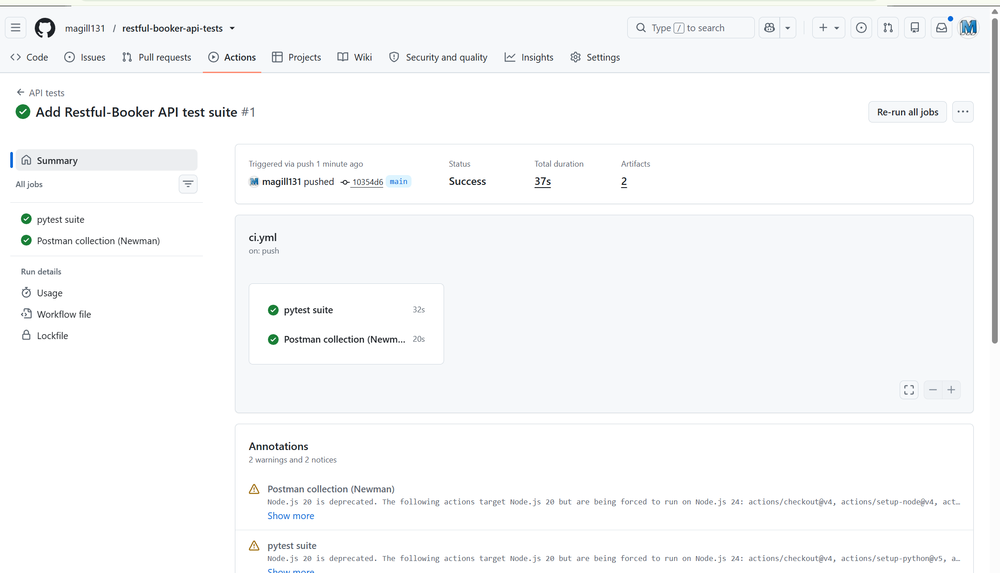

# Restful-Booker API Test Suite

API test automation for [Restful-Booker](https://restful-booker.herokuapp.com/), a public booking API built for testing practice. The same checks exist in two forms: a **Python (pytest and requests)** suite and a **Postman collection run with Newman**. Both run on every push through GitHub Actions.

## What was tested

22 pytest tests and a 12-request Postman collection (22 assertions) across four areas:

| Area | Coverage |
|---|---|
| Health and auth | Ping returns 201, response time, valid credentials return a token, invalid credentials return no token |
| Create and read | Create returns an id and echoes the data, response schema validation, get by id, content type, booking appears in the list, filter by first name |
| Update and delete | Full update, update with token and with basic auth, partial update changes only the given fields, delete returns 201, deleted booking returns 404 |
| Negative cases | Update, partial update and delete without authentication return 403, unknown booking id returns 404, create with missing fields is rejected |

Tests are tagged `smoke` (core flows) or `regression` (full coverage).

## Tools

- Python 3, pytest, requests, jsonschema, pytest-html
- Postman collection and Newman (command line runner)
- GitHub Actions for CI

## Project structure

```
api/              Client class wrapping the endpoints, test data builder, JSON schemas
tests/            pytest files by area
conftest.py       Fixtures: API client, auth token, a booking created and cleaned up per test
config.py         Base URL and the demo credentials published for the API
postman/          Collection and environment files
.github/workflows/ci.yml
```

## Design notes

- Each test that needs a booking creates its own and deletes it afterward, so tests do not depend on each other or on the demo data, which anyone can change.
- Booking first names are unique per test, so list and filter checks find the right booking.
- Responses are validated against JSON schemas, not only status codes.
- The Postman collection runs in order: auth, create, read, update, delete. It saves the token and booking id as variables between requests.

## How to run

pytest suite:

```bash
python -m venv .venv
source .venv/bin/activate        # Windows: .venv\Scripts\activate
pip install -r requirements.txt

pytest                           # all tests
pytest -m smoke                  # smoke tests only
```

The HTML report is written to `reports/report.html`.

Postman collection (needs Node.js):

```bash
npx newman run postman/restful-booker.postman_collection.json -e postman/restful-booker.postman_environment.json
```

You can also import the two files in `postman/` into the Postman app.

## Continuous integration

`.github/workflows/ci.yml` has two jobs that run on every push to `main` and every pull request: the pytest suite and the Newman run. Each uploads its report as a build artifact.

## Results


